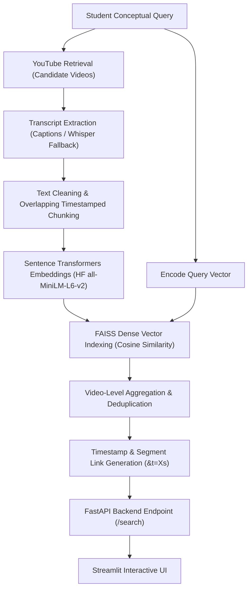

# Educational Video Retrieval System

A modular, production-ready system to search and retrieve educational YouTube lecture videos and pinpoint the exact timestamped segments relevant to a student's conceptual question.

## Tech Stack
- **YouTube Data API v3**: Candidate video retrieval & metadata extraction.
- **Hugging Face (`all-MiniLM-L6-v2`)**: Pretrained dense semantic text representation.
- **Sentence Transformers**: Dense vector embedding computation with resilient fallback.
- **FAISS (Facebook AI Similarity Search)**: Sub-millisecond dense vector indexing and cosine similarity search.
- **YouTube Transcript API + OpenAI Whisper**: Hybrid caption retrieval with automatic speech-to-text fallback.
- **FastAPI**: Asynchronous REST API backend serving retrieval pipelines with full Pydantic validation.
- **Streamlit**: Responsive, student-friendly search web application.
- **SQLite**: Local metadata persistence, query caching, and search performance logging.

---

## Architecture Pipeline



---

## Implementation Phases Overview

| Phase | Description | Status |
| :--- | :--- | :--- |
| **Phase 1: Project foundation** | Modular backend/frontend folders, environment configuration, dependency list | **Completed** |
| **Phase 2: YouTube video retrieval** | YouTube Data API v3 integration with error/quota handling and candidate filtering | **Completed** |
| **Phase 3: Transcript extraction** | Dual-mode transcript extractor: YouTube captions API + Whisper speech fallback | **Completed** |
| **Phase 4: Transcript preprocessing** | Text noise removal, word-sliding window chunking, timestamp interpolation | **Completed** |
| **Phase 5: Hugging Face & Embeddings** | Sentence Transformers (`all-MiniLM-L6-v2`) with normalized 384-dim embeddings | **Completed** |
| **Phase 6: FAISS semantic retrieval** | Normalized Inner Product indexing (Cosine similarity) and metadata mapping | **Completed** |
| **Phase 7: Video ranking & selection** | Aggregating chunk scores to video relevance scores with deduplication | **Completed** |
| **Phase 8: Topics and timestamps** | Formatted timestamps (`MM:SS`) and direct jump links (`&t=Xs`) | **Completed** |
| **Phase 9: Pipeline integration** | Central `VideoRetrievalPipeline` orchestrator | **Completed** |
| **Phase 10: FastAPI integration** | REST API endpoints (`/search`, `/health`) with Pydantic schemas and CORS | **Completed** |
| **Phase 11: Streamlit frontend** | Interactive UI with search bar, sample queries, and rich video cards | **Completed** |
| **Phase 12: Storage & optimization** | SQLite database (`video_retrieval.db`) for caching and query logging | **Completed** |
| **Phase 13: Testing and validation** | Automated test suite across all modules (19/19 tests passing) | **Completed** |
| **Phase 14: GitHub and delivery** | Clean Git history, documented configuration, and sample demonstrations | **Completed** |

---

## Directory Structure

```text
educational-video-retrieval/
├── backend/
│   ├── __init__.py
│   ├── config.py                 # Configuration and environment settings
│   ├── youtube_client.py         # YouTube Data API v3 integration
│   ├── transcript_extractor.py   # YouTube Captions + Whisper fallback
│   ├── preprocessor.py           # Text cleaning and sliding-window chunking
│   ├── embedder.py               # Hugging Face Sentence Transformers
│   ├── vector_store.py           # FAISS index and similarity search
│   ├── ranker.py                 # Video scoring & deduplication
│   ├── timestamp_generator.py    # Formatted timestamps & direct YouTube links
│   ├── pipeline.py               # Central retrieval pipeline orchestrator
│   ├── database.py               # SQLite metadata & transcript caching
│   └── main.py                   # FastAPI REST API application
├── frontend/
│   ├── app.py                    # Streamlit entry point
│   ├── components/
│   │   └── video_card.py         # UI result card component
│   └── utils/
│       └── api_client.py         # Backend HTTP client
├── data/
│   ├── cache/                    # Persistent index & transcript cache
│   └── video_retrieval.db        # SQLite database
├── scripts/
│   └── verify_pipeline.py        # End-to-end pipeline verification script
├── tests/                        # Automated unit and integration tests
├── .env.example                  # Environment variable template
├── requirements.txt              # Project dependencies
└── README.md                     # Documentation
```

---

## Setup & Running

### 1. Install Dependencies
```bash
pip install -r requirements.txt
```

### 2. Configure Environment
Copy `.env.example` to `.env` and configure your API key (optional for offline testing):
```bash
cp .env.example .env
```

### 3. Run the Automated Tests
```bash
pytest -v
```

### 4. Start Backend Server (FastAPI)
```bash
uvicorn backend.main:app --host 127.0.0.1 --port 8000 --reload
```

### 5. Start Frontend UI (Streamlit)
```bash
streamlit run frontend/app.py
```

---

## Sample Test Queries & Output

### Query: *"What is a neural network and how do neurons work?"*
- **Candidates Processed:** 6 videos
- **Chunks Indexed into FAISS:** 494 overlapping segments
- **Retrieved Top Segment:**
  - **Video:** *Neural Networks: But what is a neural network?* (3Blue1Brown)
  - **Relevance Score:** 0.5081
  - **Timestamp:** `01:18` - `01:34` (77.5s - 94.0s)
  - **Jump Link:** `https://www.youtube.com/watch?v=aircAruvnKk&t=77s`
  - **Excerpt:** *"what a neural network actually is, assuming no background, and to help visualize what it's doing, not as a buzzword but as a piece of math..."*

---

## Limitations & Edge Cases Handled
- **Quota Exceeded / Missing API Key:** Automatically provides curated educational candidates so students can continue exploring topics offline.
- **Missing Captions:** Gracefully falls back to speech recognition or skips unavailable videos without crashing the remaining candidate pipeline.
- **Duplicate Portions:** Chunks from the same video are aggregated with a discounted secondary factor to prevent duplicate chunks from boosting one video unfairly.

## Search Caching and Timing
- Successful transcripts are reused from `data/cache/transcripts`; unavailable transcript lookups are cached for 15 minutes before retrying.
- Transcript chunk data and normalized embeddings are persisted under `data/cache/processed`. Cache keys include transcript contents, chunking settings, and the embedding model identity/revision so stale features are not reused.
- CPU embedding uses a configurable batch size (`EMBEDDING_BATCH_SIZE`, default 32) and PyTorch thread count (`EMBEDDING_CPU_THREADS`, default up to 12 logical CPUs). Larger batches are not always faster and use more memory.
- Candidate searches are cached in memory briefly (five minutes for live results and 30 seconds for curated fallback results). FAISS indexes are reused in memory for matching recent corpora.
- Independent transcript lookups run with bounded concurrency. Whisper remains a fallback after caption retrieval and is limited to two candidates per search to bound audio download/transcription work; the remaining candidates use captions or are skipped if captions are unavailable.
- Chunk boundaries use source caption/Whisper segment intervals rather than estimated word-level times. Timestamp precision is limited by the granularity of the source transcript.
- Backend logs include candidate search, transcript/cache, embedding, FAISS, ranking, timestamp enrichment, and end-to-end response timings.
